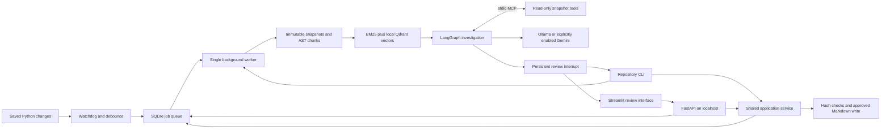

# Architecture and engineering decisions

## Repository truth

Git enumerates candidate tracked and untracked paths. Ignore rules are also checked for tracked files. The scanner independently applies hard exclusions, custom ignores, path containment, link rejection, byte limits, and syntax checks. It records normalized source text plus original hashes, newline style, and BOM information.

Each snapshot ID incorporates project identity and all eligible file hashes. A separate source hash covers Python files, allowing a documentation refresh without pretending the code changed. The last analyzed source snapshot advances after completed decisions or prepared proposals; rejected proposals therefore do not recur on the same revision.

Read-only MCP tools use stored snapshots, not changing files on disk. Project/snapshot identity checks prevent cross-project retrieval. Python is parsed, never imported or executed.

## Retrieval

AST chunks preserve function/class boundaries and index uncovered module code. Large chunks are split with a conservative UTF-8 byte bound. Markdown headings define sections. Stored payloads retain path, symbol, line range, original text, and snapshot identity.

Ollama embeddings use `search_document:` and `search_query:` prefixes and disable silent truncation. The cache key includes the installed model digest and input text. A new embedding-model digest creates a separate Qdrant collection. Indexing reuses unchanged cached vectors.

BM25, exact-symbol matches, approximate related-symbol matches, and vector similarity contribute reciprocal ranks. Qdrant queries filter by snapshot ID. The agent receives up to eight supplementary chunks plus the changed code. It can gather more evidence through MCP, subject to its tool and context budgets.

## Agent and model boundary

LangGraph persists node state in a separate SQLite checkpoint database. Pydantic validates model decisions and drafts. The model selects from a fixed read-only tool list; project and snapshot arguments are injected by the application. There is one structured-output retry and no unbounded autonomous loop.

The graph prepares at most five target documents, checks edits against allowed sections, then pauses at an interrupt. Review decisions are handled by the shared application write service, called by either the CLI or FastAPI; once all proposals for that job are terminal, a worker job resumes the checkpoint. Tool summaries, sources, timings, and reported token counts are stored. No hidden reasoning transcript is requested.

Local mode accepts loopback service URLs and rejects known remote/cloud Ollama model references. Gemini is a separate provider branch whose consent is re-read before every call. Embeddings always use the local branch. External tracing is explicitly disabled.

## Approval and recovery

Only the review service writes repository files, and only under `docs/` with `.md` suffixes. It locks per project, rechecks source and destination hashes, stages bytes in the destination directory, flushes them, and atomically replaces the file. Backups and an `applying` journal state allow crash reconciliation. A developer can still edit files concurrently; hashes prevent stale approvals, but this is not an operating-system lock on the developer’s editor.

One worker owns the queue under a process lock. Running jobs are recovered to queued after restart. Completed graph nodes and review interrupts are reused. Filesystem events that arrive during a job are coalesced; a final source check supersedes outdated proposals and queues a newer scan. Failed service calls remain explicit failures and never trigger a provider switch.

## Public interfaces

The npm package `@aadityarajput75/docsync` exposes a Node launcher. It bundles an allowlisted copy of the Python application and its lockfile. First invocation provisions uv if needed (version-pinned official installer, verified SHA-256), Python 3.12, and dependencies in a user cache. Runtime installation strips the Gemini key and avoids modifying the project's virtual environment or system Python registration. Later invocations reuse that environment. Python and MCP entry points use isolated mode so a module in the target repository cannot shadow DocSync at startup.

Bare `docsync` from the npm launcher invokes `run`: provider consent, local-service/model checks, optional model download approval, registration/indexing, an initial overview proposal when appropriate, and watching. `--yes` approves model downloads only. The npm launcher defaults to Qdrant's embedded disk backend under `.docsync/vectors`; it needs no Docker server. The original Python-source mode keeps the Qdrant server default. `DOCSYNC_QDRANT_MODE` chooses explicitly; all processes sharing state must agree. The embedded client opens lazily after the worker lock, and one-shot CLI jobs close it before another job starts.

The repository CLI uses the same `Service` as FastAPI in-process. It does not require an HTTP server. `init`, `index`, `draft`, and `scan` acquire the worker lock, recover interrupted jobs, and process the queue up to their requested job; if another worker owns the lock, they wait for that worker to finish the requested job. `watch` runs the existing worker with terminal progress. `review` delegates acceptance, editing, and rejection to the shared review service. Follow-up indexing and checkpoint-resume jobs run during watch or the next processing command.

Repository commands discover the nearest Git root and default to its `.docsync` state directory. An explicit `--data-dir` overrides `DOCSYNC_DATA_DIR`, which overrides that default. Legacy `start`, `api`, `worker`, and `ui` commands retain their launch-directory default; setting `DOCSYNC_DATA_DIR` makes all interfaces share existing state. Credentials remain environment-only. Interactive editing opens a temporary Markdown copy and asks before applying it; `--accept` and `--file` explicitly authorize the review action in scripts.

FastAPI’s generated `/openapi.json` is the authoritative HTTP schema. Project settings expose watching, ignore patterns, provider, and cloud consent. Jobs expose IDs, lifecycle state, progress, activity, usage, and proposal IDs. Proposals expose original/proposed content, deterministic diff, source revision, target hash, evidence, and review state.

MCP publishes `list_tree`, `read_file`, `search_text`, `find_symbol`, and `get_related_symbols`. All require a project ID and snapshot ID, and return bounded JSON evidence. There is deliberately no arbitrary shell or write tool.
